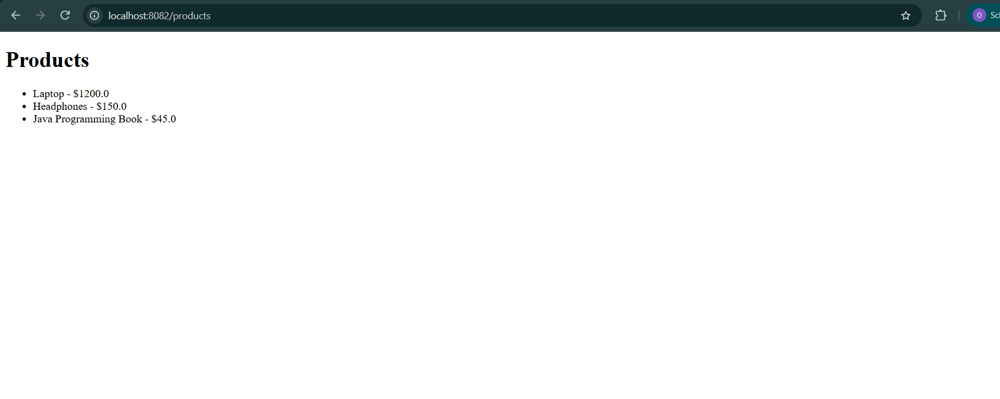
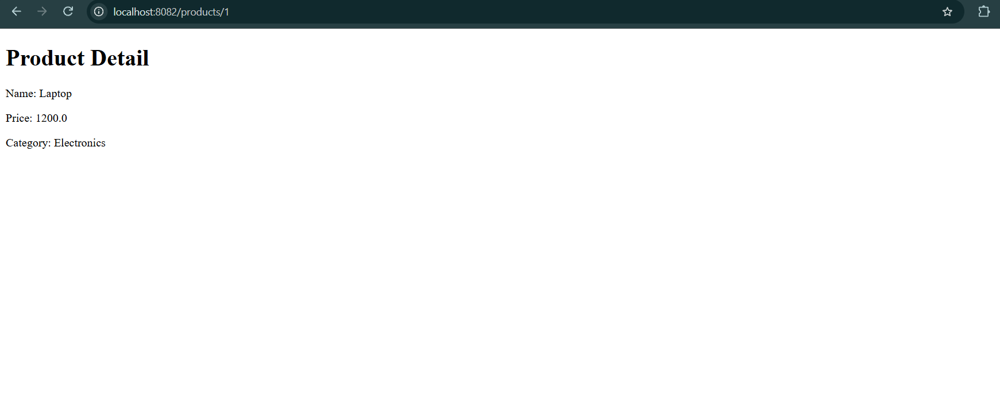
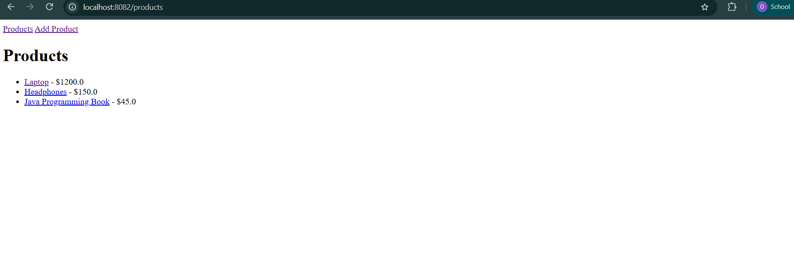
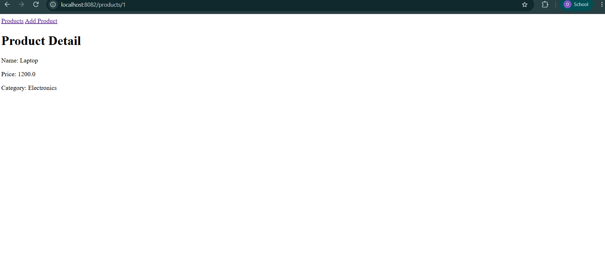
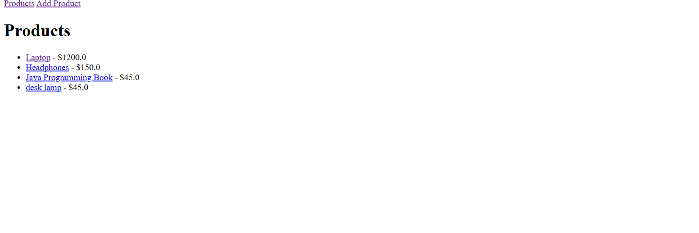
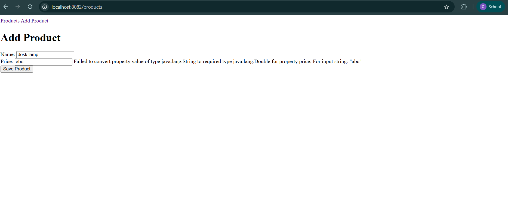

# Lab 4: Server-Rendered CRUD Interface

## Student Information

| Field | Value |
|---|---|
| Name | Owen Ezekiel A. Anchola |
| Student ID | 2511003 |
| GitHub Repository URL | https://github.com/owenezekielanchola-ops/webdev2 |
| Branch | [`week4`](https://github.com/owenezekielanchola-ops/webdev2/tree/week4) |

---

## Task 1 — Product List Template

- **Template:** [`src/main/resources/templates/products.html`](https://github.com/owenezekielanchola-ops/webdev2/blob/week4/src/main/resources/templates/products.html)
- **Controller Endpoint:** `GET /products` in [`ProductController.java`](https://github.com/owenezekielanchola-ops/webdev2/blob/week4/src/main/java/com/copal/webdev2/controler/ProductController.java)

Renders the list of products using `th:each="product : ${products}"` and `th:text="${product.name}"`, and shows `<p th:if="${#lists.isEmpty(products)}">No products available.</p>` only when the list is empty.

```html
<p th:if="${#lists.isEmpty(products)}">No products available.</p>

<ul th:unless="${#lists.isEmpty(products)}">
    <li th:each="product : ${products}">
        <a th:href="@{/products/{id}(id=${product.id})}" th:text="${product.name}"></a>
        - $<span th:text="${product.price}"></span>
    </li>
</ul>
```

**Evidence Screenshot:**



---

## Task 2 — Product Detail Template

- **Template:** [`src/main/resources/templates/product-detail.html`](https://github.com/owenezekielanchola-ops/webdev2/blob/week4/src/main/resources/templates/product-detail.html)
- **Controller Endpoint:** `GET /products/{id}` in [`ProductController.java`](https://github.com/owenezekielanchola-ops/webdev2/blob/week4/src/main/java/com/copal/webdev2/controler/ProductController.java)

Displays the requested product's `name`, `price`, and nested property `product.category.name` using Thymeleaf variable expressions (`${...}`).

```html
<div th:if="${product != null}">
    <p>Name: <span th:text="${product.name}"></span></p>
    <p>Price: <span th:text="${product.price}"></span></p>
    <p>Category: <span th:text="${product.category.name}"></span></p>
</div>
```

**Evidence Screenshot:**



---

## Task 3 — Shared Navigation Fragment

- **Fragment:** [`src/main/resources/templates/fragments/navbar.html`](https://github.com/owenezekielanchola-ops/webdev2/blob/week4/src/main/resources/templates/fragments/navbar.html)
- **Included in:** `products.html`, `product-detail.html`, and `product-form.html` via `<div th:replace="~{fragments/navbar :: navbar}"></div>`

```html
<nav th:fragment="navbar">
    <a th:href="@{/products}">Products</a>
    <a th:href="@{/products/new}">Add Product</a>
</nav>
```

**Evidence Screenshots (Navbar on Both Pages):**





---

## Task 4 — Create Form

- **Template:** [`src/main/resources/templates/product-form.html`](https://github.com/owenezekielanchola-ops/webdev2/blob/week4/src/main/resources/templates/product-form.html)
- **Controller Endpoints:** `GET /products/new` and `POST /products` in [`ProductController.java`](https://github.com/owenezekielanchola-ops/webdev2/blob/week4/src/main/java/com/copal/webdev2/controler/ProductController.java)

Binds to `${product}` using `th:object`, uses `th:field="*{name}"` and `th:field="*{price}"`, posts to `th:action="@{/products}"`, and redirects back to `/products` upon successful submission.

**Evidence Screenshot:**



---

## Task 5 — Binding Errors on the Create Form

- **Controller Method:** `createProduct(@ModelAttribute Product product, BindingResult result)` in [`ProductController.java`](https://github.com/owenezekielanchola-ops/webdev2/blob/week4/src/main/java/com/copal/webdev2/controler/ProductController.java)
- **Template:** [`src/main/resources/templates/product-form.html`](https://github.com/owenezekielanchola-ops/webdev2/blob/week4/src/main/resources/templates/product-form.html)

```java
@PostMapping
public String createProduct(@ModelAttribute Product product, BindingResult result) {
    if (result.hasErrors()) {
        return "product-form";
    }
    ...
    return "redirect:/products";
}
```

```html
<div>
    <label>Price:</label>
    <input type="text" th:field="*{price}" />
    <span th:if="${#fields.hasErrors('price')}" th:errors="*{price}"></span>
</div>
```

**Evidence Screenshot:**


